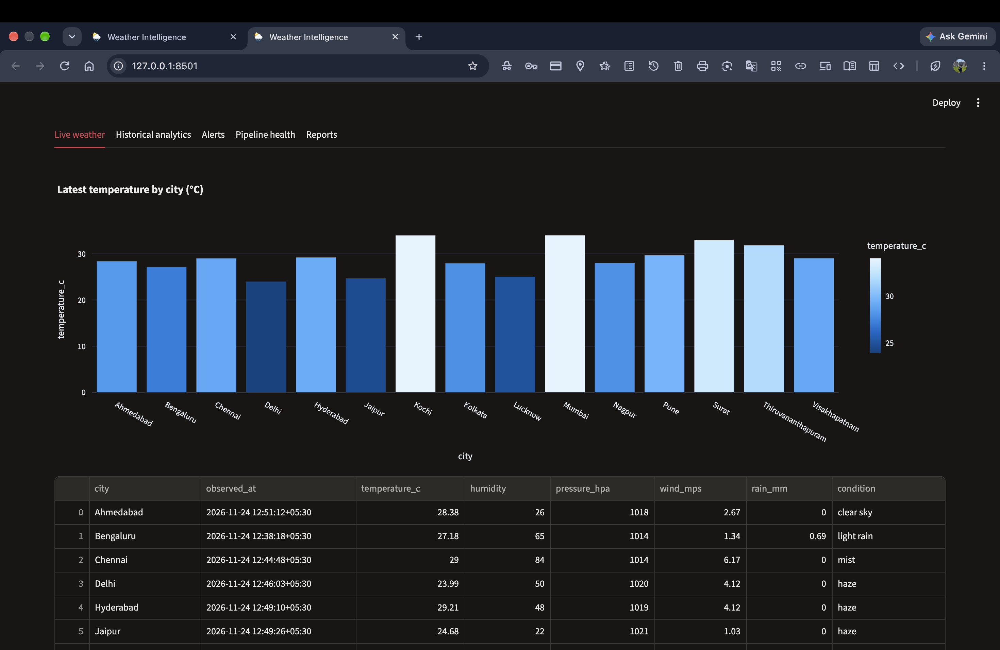
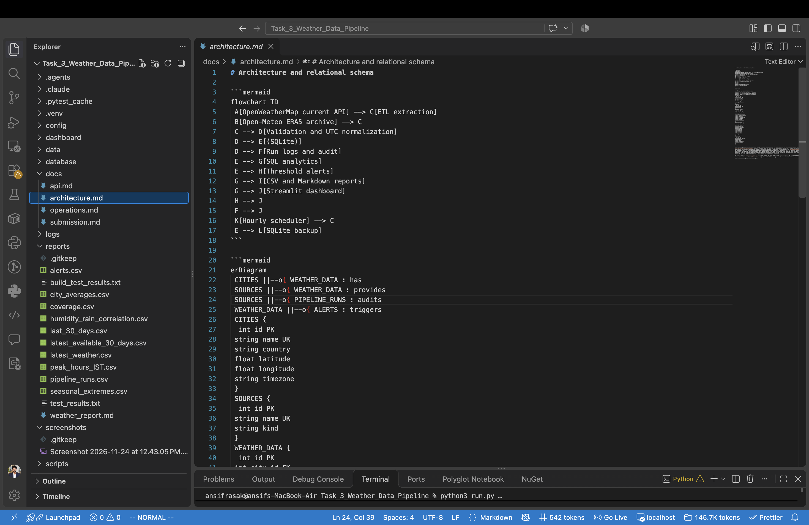
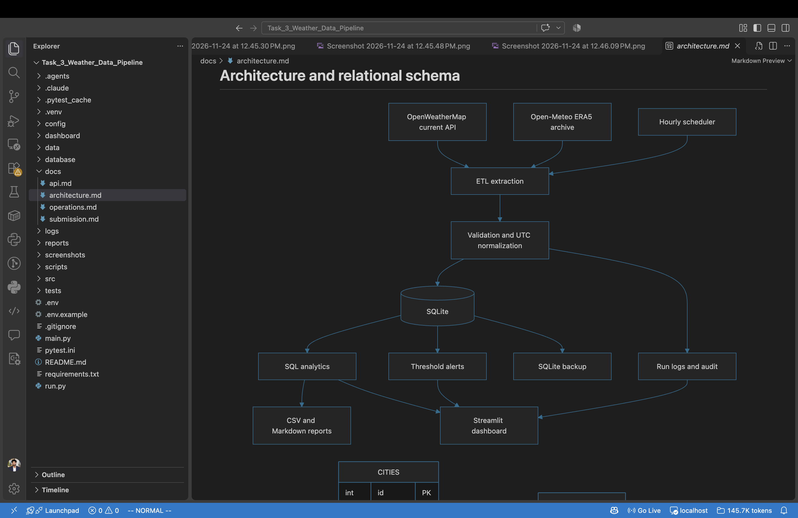
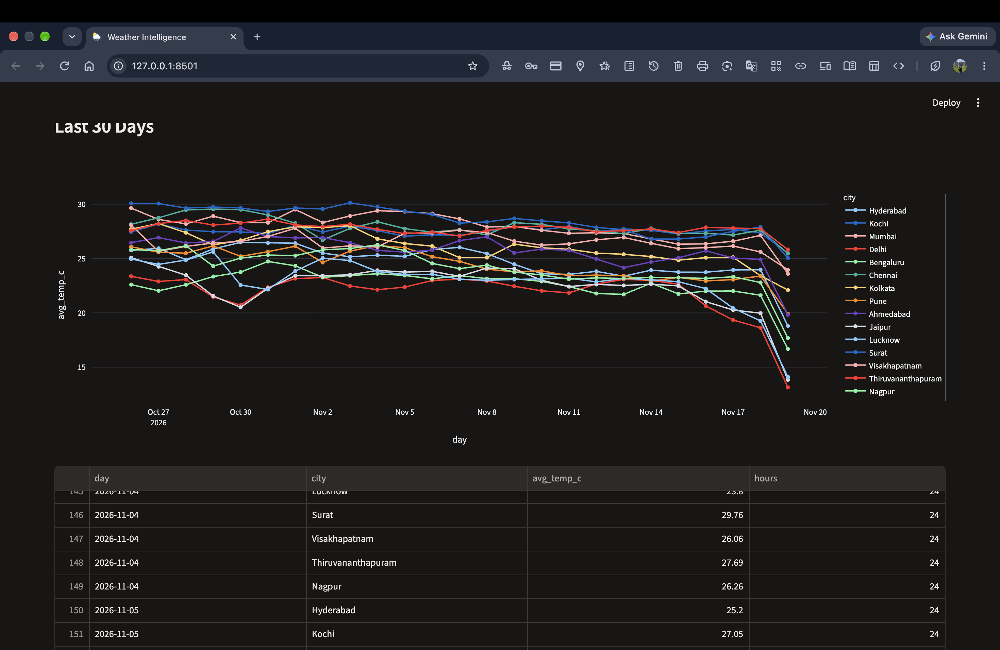
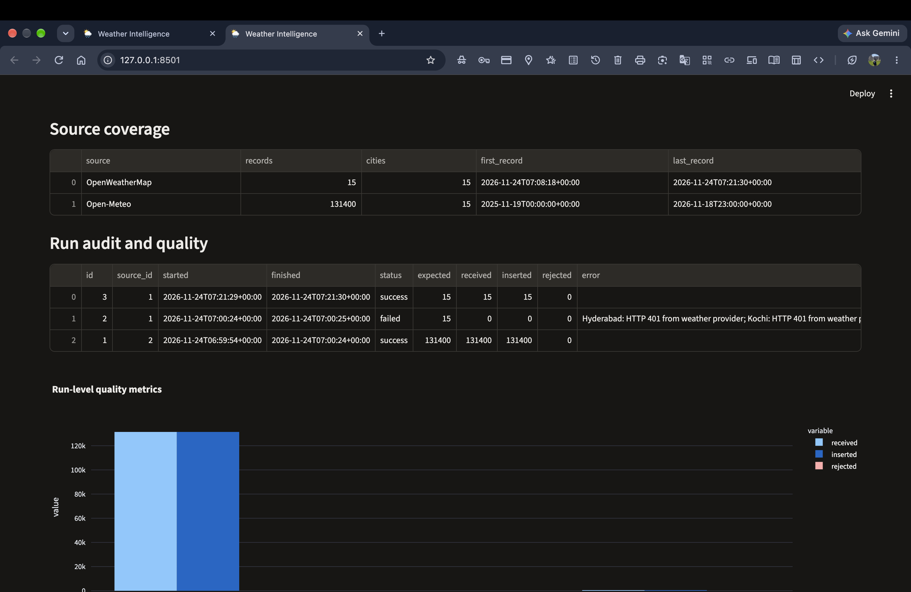
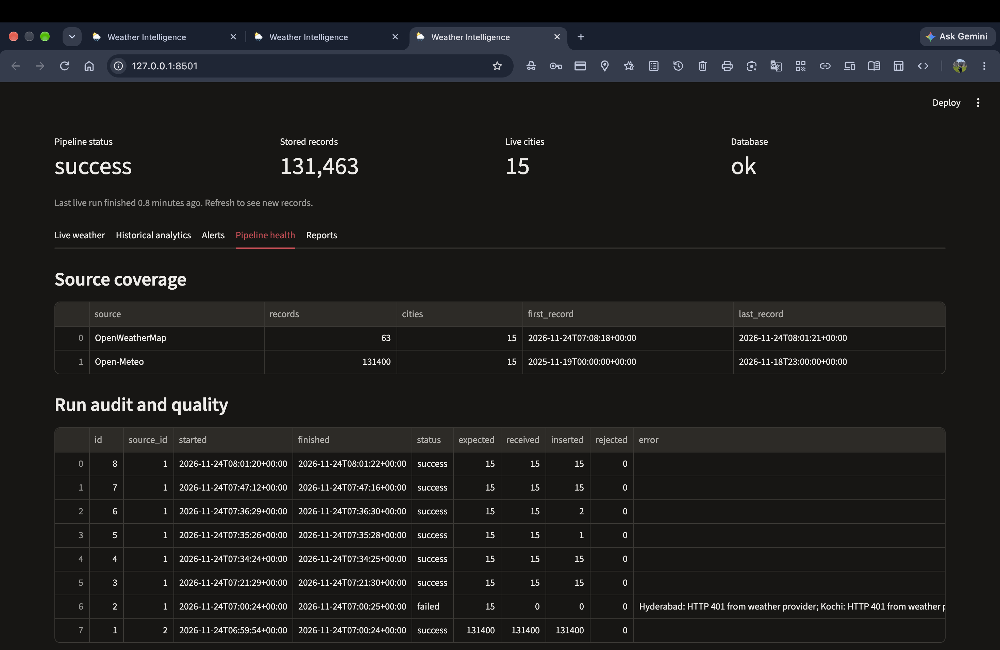
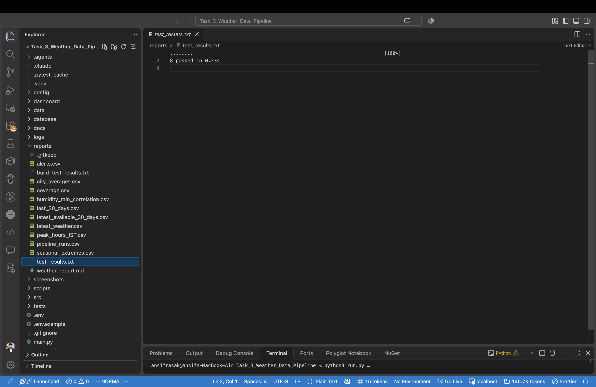

# Task 3 | Weather Data Pipeline & Intelligence Dashboard

Developers Arena Data Science internship — advanced version. A local, reproducible ETL system for 15 Indian cities. Current weather is fetched from OpenWeatherMap and historical hourly estimates from Open-Meteo ERA5. Sources are stored separately; no synthetic records are inserted into the production database.

## Quick start (macOS / VS Code)
1. Install Python 3.10+ and open this folder in VS Code. Obtain your own API key from https://home.openweathermap.org/api_keys (account and activation required).
2. Open `run.py` and click **Run Python File** (triangle, upper right). Run in the integrated terminal, not the Output pane. Alternatively run `python3 run.py` once in the folder.
3. Paste the API key into the hidden terminal prompt and press Enter. It is stored locally in `.env`, excluded from Git. Press Enter without a key only for historical mode; live collection is required before submission.
4. The launcher creates a local virtual environment, installs requirements, imports up to 365 days of historical hourly data, collects live weather, creates reports, backs up the database, runs tests, and starts the dashboard plus hourly scheduler. Open the local Streamlit URL printed in the terminal (normally http://127.0.0.1:8501).
5. Keep the Mac awake and the terminal open for hourly collection. Refresh the dashboard to read new records. Stop with Ctrl+C. Run again to restart; the database remains on disk.

## Architecture
OpenWeatherMap / Open-Meteo → extraction → validation → SQLite → SQL analytics → reports, alerts, Streamlit. Pipeline runs and health indicators are audited separately. See [architecture and schema](docs/architecture.md), [API reference](docs/api.md), [operations and testing](docs/operations.md), and [submission checklist](docs/submission.md).

## Outputs and interpretation
- `database/weather_data.db`: actual acquired data, with distinct source identities; archive modeled estimates are not live observations.
- `reports/`: six analytics CSV files (five questions plus the latest available 30-day window), current snapshots, alerts, source coverage, run history, Markdown summary and test results.
- `logs/pipeline.log`: runtime events, with no API keys.
- `dashboard/app.py`: live, historical, alerts, pipeline status and report downloads.
- The last-30-days report uses the actual local calendar window. ERA5 has publication latency; the import deliberately ends six UTC days before today. Missing dates are not invented. A separate latest-available 30-day series provides a fuller comparison ending at the latest archive date. A year of archive data is sufficient to compare sampled seasons, not a climatological conclusion.
- Thresholds (project definitions, not official warnings): hot >=40°C, cold <=5°C for historical extremes, rain >=20 mm/hour, humidity >=90% for live alerts. Seasons use fixed Indian month groupings. Peak hours are IST hour buckets; samples occur on the UTC hour (IST half-hour).
- See the `coverage.csv` and per-day sample counts before drawing conclusions; missing records and partial runs are possible.

## Manual commands (optional maintenance)
Use the Python interpreter under `.venv` (macOS: `.venv/bin/python`). Run `main.py init`, `main.py history`, `main.py live`, `main.py report`, `main.py backup` or `main.py schedule` after the interpreter command. For tests: `.venv/bin/python -m pytest -q`.

## Data attribution
OpenWeatherMap current weather API: https://openweathermap.org/api/current. Open-Meteo historical API (ERA5, Copernicus Climate Change Service): https://open-meteo.com/en/docs/historical-weather-api. Observe provider usage and attribution terms, particularly for redistribution.

## Verified Project Results

| Metric | Verified Result |
|---|---|
| Total weather records | 131,467 |
| Historical weather records | 131,400 |
| Indian cities monitored | 15 |
| Relational database tables | 5 |
| Weather data sources | 2 |
| Pipeline runs at verification | 12 |
| Automated tests passed | 8/8 |
| Database size | 24.97 MB |
| Normal collection interval | 60 minutes |
| Downloadable reports | 11 |

Verification date: November 24, 2026.
Record counts increase during subsequent collection runs.

## Key Analytical Findings

- Chennai recorded the highest annual average
  temperature at 28.66°C among the tracked cities.
- Several cities showed cooling trends from late
  October to mid-November.
- The reviewed humidity and rainfall correlations
  showed weak positive relationships.
- The pre-monsoon season recorded the highest
  extreme weather frequency at 2.48%.
- The reviewed cities generally reached peak
  average temperatures between 1 PM and 2 PM IST.

## System Verification

- Successful live API collection for all 15 cities.
- Historical ingestion of 131,400 weather records.
- Automatic scheduled collection verified at
  one-minute testing intervals.
- Duplicate prevention verified during repeated runs.
- Database backup successfully generated.
- API authentication failure and recovery recorded
  in the pipeline audit history.
- All eight automated tests passed on macOS.

## Additional Data Quality Notes

November 19, 2026 contains incomplete daily
records for 15 cities because of the historical
archive boundary. These partial daily averages
should not be treated as full-day averages.

No missing observations have been fabricated.

## Project Screenshots

### Live Weather Dashboard

### System Architecture

### Database ER Diagram

### Historical Temperature Analysis

### Pipeline Monitoring

### Automated Scheduler Verification

### Automated Testing

## Internship Details

- Organization: The Developers Arena
- Domain: Data Science
- Task: Month 3 - Database Management & APIs
- Project: Complete Weather Data Pipeline System
- Project Level: Advanced