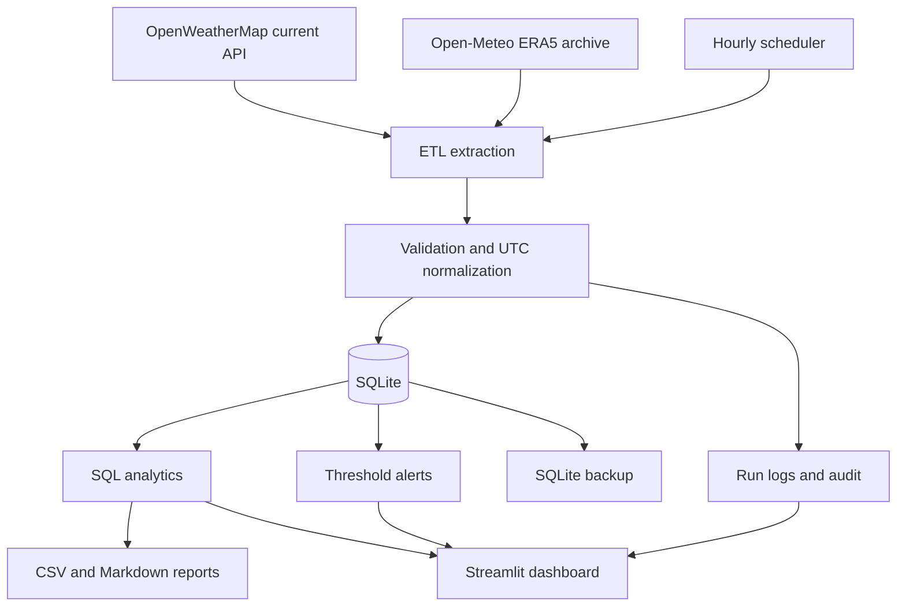
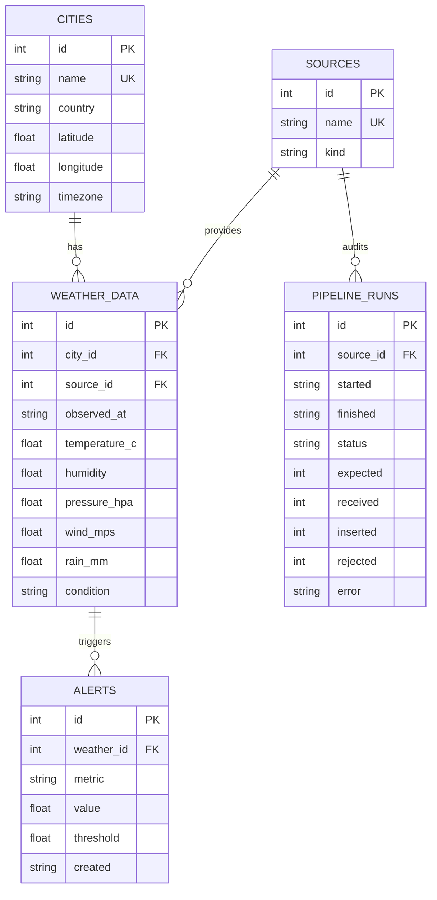

# Architecture and relational schema

Five tables separate location identity, data provenance, measurements, ETL audit and alerts. The compound unique key `(city_id, source_id, observed_at)` prevents repeated imports. Each non-key measurement is tied to a single source/city/time observation. Foreign keys are enabled on every connection; WAL and transactions protect writes. See `database/schema.sql` for executable DDL. UTC ISO timestamps are normalized before insertion; analytics convert to IST. API retry is bounded; invalid data is rejected, not replaced with zero (except absent live rain, interpreted as no reported rain in the provider response). Pipeline expected/received/inserted/rejected counts distinguish failed extraction and duplicate rows. Audit records do not link each observation to a run; this is a local project limitation.

SQL implementations in `src/analytics.py` cover JOIN, GROUP BY, AVG, COUNT, CASE, date functions, CTE and ROW_NUMBER. Pearson correlation is calculated in pandas on SQL-extracted matched hourly rows. All historical comparisons use only ERA5 data to avoid mixing source methodologies.
